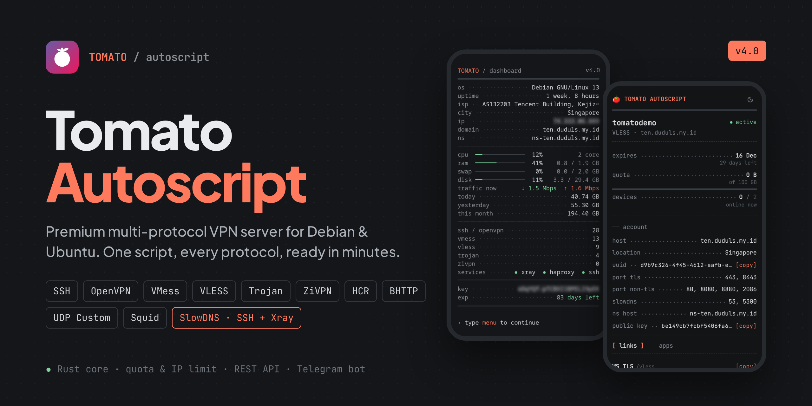
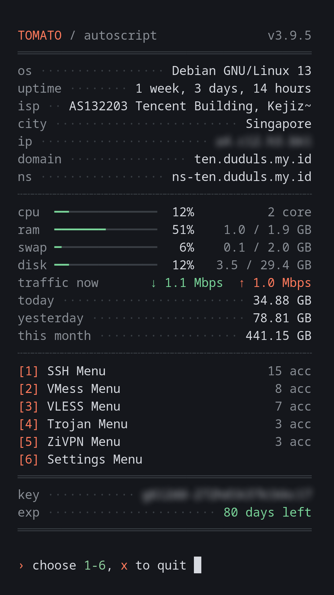
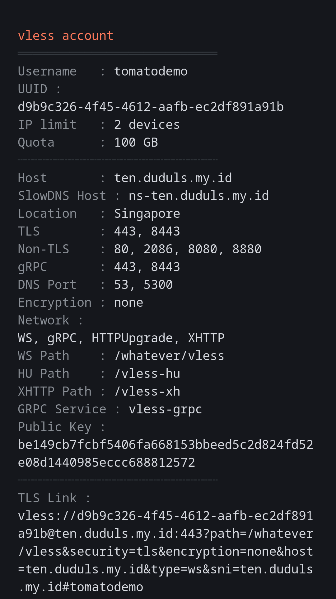
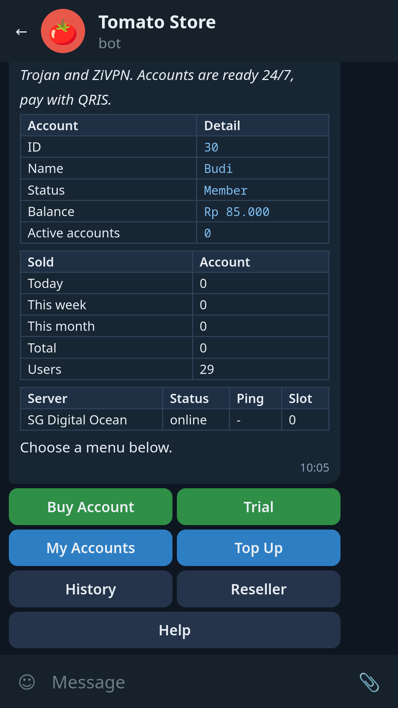

  

  
  
  
  

# Tomato Autoscript

Multi-protocol VPN server autoscript for Debian and Ubuntu. One install sets up
SSH, OpenVPN, Xray (VMess, VLESS, VLESS REALITY, Trojan), ZiVPN, SlowDNS, UDP
Custom and a Squid proxy, managed from a terminal menu, a Telegram bot or a REST
API. The SSH core is written in Rust and runs on a 1 core / 1 GB RAM VPS.

This repository is a showcase: it has the documentation and screenshots, not the
source code. Installing needs a license from
[store.dudul.my.id/license](https://store.dudul.my.id/license).

## What's new in 4.0

- VLESS REALITY on port 443 with up to 3 SNI per server. Every VLESS account gets
  the REALITY link automatically.
- Each REALITY SNI is checked for TLS 1.3 and X25519 before it is saved.
- Xray-core 26.11.9 and ZiVPN rebuilt with security fixes.
- The update checks the Xray config before restarting and rolls back if it
  fails. Relay routing is migrated automatically.

## Protocols and ports

| Service | Port |
|---|---|
| SSH (Tomato Proxy) | `109` `143` |
| SSH WebSocket | `80` `2086` `8080` `8880`, SSL `443` `8443` |
| SSH SSL / SNI | `443` `8443` |
| Squid proxy (SSH remote proxy) | `3128` `8000` |
| OpenVPN TCP / UDP / SSL | `1194` / `2200` / `443` `8443` |
| OpenVPN WebSocket / SSL WS | `80` `2086` `8080` `8880` / `443` `8443` |
| VLESS REALITY | `443` (up to 3 SNI) |
| VMess, VLESS (WS, gRPC, HTTPUpgrade, XHTTP) | TLS `443` `8443`, non-TLS `80` `2086` `8080` `8880` |
| Trojan (WS, gRPC, HTTPUpgrade, XHTTP) | TLS `443` `8443` |
| SlowDNS (SSH, VMess, VLESS, Trojan) | `53` `5300` |
| ZiVPN UDP | `5667` `6000-19999` |
| HCR / BHTTP | `2087` / `2082` `2096` |
| UDP Custom | `1-65535` (except the ZiVPN range) |
| UDPGW | `7100` `7200` `7300` |

One SSH account works on every SSH-based path: WebSocket, SSL, Squid, OpenVPN,
HCR, BHTTP, SlowDNS and UDP Custom.

## Features

- Quota and IP limit on every protocol, including SSH, OpenVPN and ZiVPN.
- Check Login shows each user's mobile operator and city, with alerts for
  multi-login and quota.
- Lock, unlock and autolock with custom durations such as `45m` or `2d12h`.
- Custom UUID and password, from the menu or the API.
- Expired accounts are kept for 7 days (adjustable from 0 to 30). Renewing
  restores the same UUID or password.
- Subscription page for every account, including a Clash config.
- SlowDNS for SSH, VMess, VLESS and Trojan.
- REST API, a multi-server Telegram bot and automatic backup to Telegram.
- Encrypted web backup and restore. The SlowDNS and REALITY keys move with the
  backup, so clients keep working on the new VPS.
- Live dashboard and system monitor in the terminal.
- Free DNS record or your own domain, SSL auto-renew, anti-DDoS, anti-torrent
  and Xray relay routing.
- Updates keep accounts and settings, with automatic rollback if something fails.

## Requirements

| | Minimum |
|---|---|
| CPU | 1 core |
| RAM | 1 GB |
| Storage | 10 GB |
| Architecture | x86_64 (AMD64) |
| OS | Debian 12 / 13, Ubuntu 22.04 / 24.04 / 26.04 (fresh install) |
| Access | root |

Ubuntu 24.04 LTS or Debian 12 is recommended.

## Install

1. Buy a license at [store.dudul.my.id/license](https://store.dudul.my.id/license).
   Pick a duration (up to 1 year) and the IP limit.
2. Open the license page in the store, copy the install command shown there and
   run it on the VPS as root.
3. Follow the steps on screen. Use your own domain or the built-in free DNS.
4. Type `menu` to start creating accounts.

Moving to a VPS with a new IP: change the IP from the license page in the store.

Payment: QRIS, DANA, ShopeePay, bank transfer and PayPal.

## Update

`menu` › `6` Settings Menu › `16` Update script

Accounts, settings and keys are kept. If the new Xray config does not pass its
check, the previous version is restored.

## Telegram store bot

[tomato-store-bot](https://github.com/dudul19/tomato-store-bot) sells Tomato
accounts from Telegram with automatic top up through AutoGoPay, Midtrans or
Pakasir.

## Preview

  
  
  
  
  
  

More screenshots: [tomatosc.my.id/#preview](https://tomatosc.my.id/#preview).

## Support

If the script helps you, you can support the work on
[Saweria](https://saweria.co/dudulrealnofek).

## Credits

Made by [@dudulrealnofek](https://t.me/dudulrealnofek). Group: [@tfnuklir](https://t.me/tfnuklir).

Thanks to:

- [Xray-core](https://github.com/XTLS/Xray-core) (XTLS) for VMess, VLESS, REALITY and Trojan
- [David Fifield](https://www.bamsoftware.com/software/dnstt/) for dnstt (SlowDNS)
- [Hysteria](https://github.com/apernet/hysteria) (apernet) for the QUIC core behind ZiVPN
- [OpenVPN](https://openvpn.net), nginx and HAProxy
- The Rust and Go teams
