

## `Tomato Autoscript — Premium VPN Server`

`made with 🤍 from Mr dudul`

---

**One script, every protocol. Deploy a premium VPN server on your VPS in about 2 minutes.**

SSH · OpenVPN · VMess · VLESS · Trojan · ZiVPN · HCR · BHTTP · SlowDNS · UDP Custom · Squid Proxy

  
  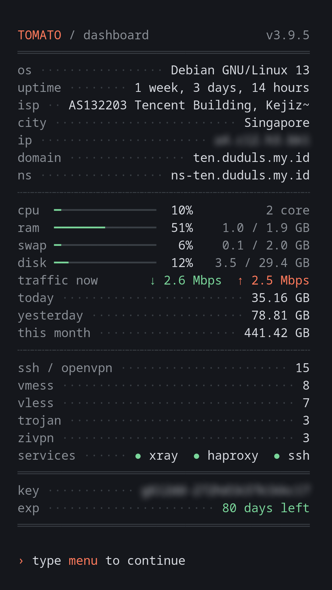

### What's New in 3.8
- **VLESS, VMess & Trojan over SlowDNS** — same NS and public key as SSH SlowDNS. Existing accounts work right away, no new account needed.
- **HTTP Custom ready** — V2Ray + SlowDNS mode: NS + public key, port `53`, WS path `/vless`, `/vmess` or `/trojan-ws`.
- **Every account output shows SlowDNS** — port, NS host and public key in the menu, subscription page, REST API and Telegram bot.
- **Faster, steadier SlowDNS** for SSH and Xray, with lower server CPU and quicker recovery after big downloads.
- **Per-device detection over SlowDNS** — Check Login, sub page, API/bot and IP limit count each phone separately.

### Why Tomato?
- **Lightweight** — the SSH core is written in **Rust** and runs comfortably on a **1 core / 1 GB RAM** VPS.
- **Quota & IP limits on every protocol** — SSH, OpenVPN and ZiVPN included, not just Xray.
- **Know who is connected** — Check Login, the sub page, the API and alerts all show the same devices, with mobile operator and city.
- **Fast SlowDNS for SSH and Xray** — tuned DNS tunnel (TXT, NULL, CNAME, MX, SRV) that keeps ping low while downloading.
- **Customers keep their config** — expired accounts are held for 7 days (0–30, adjustable); renewing restores the same UUID/password. The SlowDNS key moves with your backup to a new VPS.
- **Live monitoring** — CPU, RAM, disk and traffic bars on the login dashboard and main menu, plus a per-second System monitor.
- **Safe one-click updates** — accounts, UUIDs, quotas and bot settings are kept; if anything fails midway it rolls back automatically.
- **Ready to sell** — REST API for selling websites, multi-server Telegram bot, a subscription page for every account.
- **Regular security updates** — binaries are rebuilt whenever an important CVE lands; SSL certificates renew automatically.

### Protocols & Ports
| Service | Port |
|---|---|
| SSH (Tomato Proxy) | `109` `143` |
| SSH WebSocket | `80` `2086` `8080` `8880` · SSL `443` `8443` |
| SSH SSL / SNI | `443` `8443` |
| Squid Proxy (SSH remote proxy) | `3128` `8000` |
| OpenVPN TCP · UDP · SSL | `1194` · `2200` · `443` `8443` |
| OpenVPN WebSocket · SSL WS | `80` `2086` `8080` `8880` · `443` `8443` |
| VMess · VLESS (WS, gRPC, HTTPUpgrade, XHTTP) | TLS `443` `8443` · nTLS `80` `2086` `8080` `8880` |
| Trojan (WS, gRPC, HTTPUpgrade, XHTTP) | TLS `443` `8443` |
| SlowDNS (SSH · VMess · VLESS · Trojan) | `53` `5300` |
| ZiVPN UDP | `5667` `6000-19999` |
| HCR · BHTTP | `2087` · `2082` `2096` |
| UDP Custom | `1-65535` (except ZiVPN range) |
| UDPGW | `7100` `7200` `7300` |

> One SSH account works on every SSH-based path (WS, SSL, Squid, OpenVPN, HCR, BHTTP, SlowDNS, UDP Custom).

### Features
| Accounts | Control | Automation |
|---|---|---|
| Create, Renew, Detail, Trial | Quota & IP limit on all protocols | Expired accounts kept 7 days, renew restores them |
| Custom UUID & password (menu + API) | Optional 1 device per mobile operator | Auto-remove when quota runs out |
| Check Login with operator + city | Lock / Unlock + Autolock (any duration, e.g. `45m`, `2d12h`) | Auto backup to Telegram (SlowDNS key included) |
| Subscription links for all protocols (incl. Clash) | Multi-login & quota alerts with device operator | Encrypted web backup & restore |
| Multi-server Telegram bot (server, client, alert, backup) | Live dashboard + System monitor | Free DNS record & auto-renewing TLS |
| REST API for selling websites | Anti-DDoS, anti-torrent, Xray relay routing | Scheduled auto reboot |

### Preview

<b>Terminal Menus</b>

 

  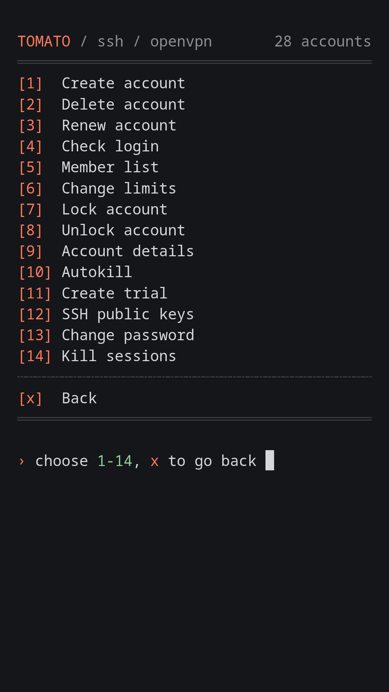
  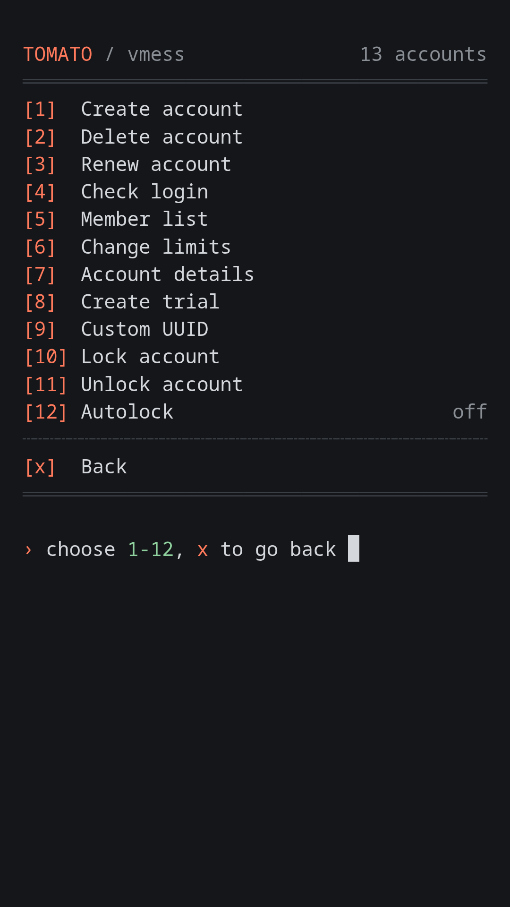
  
  
  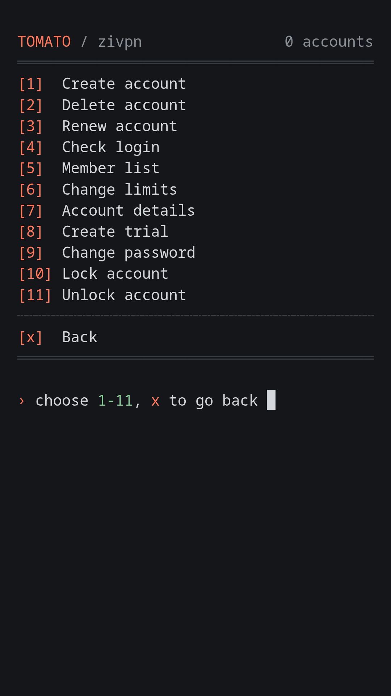
  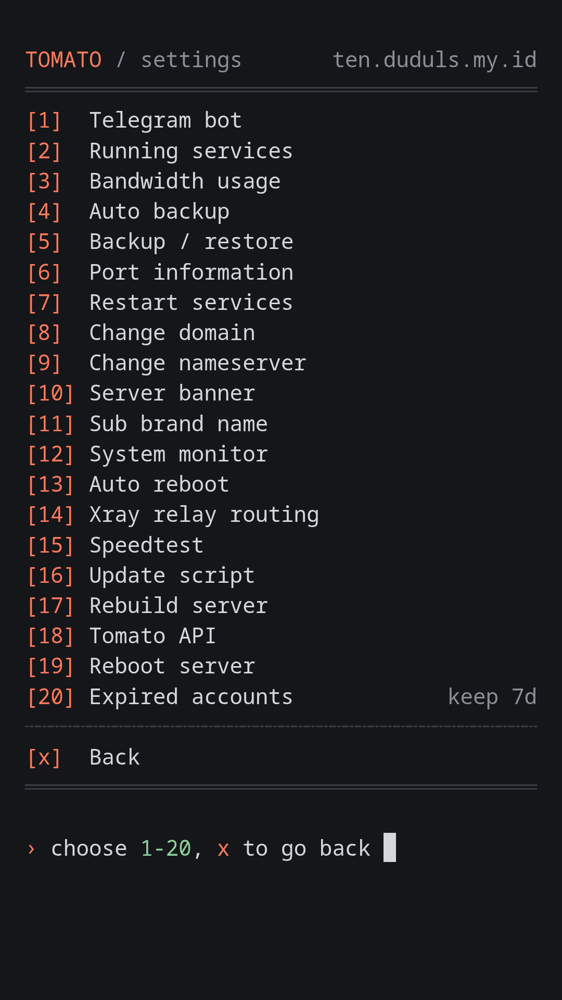
  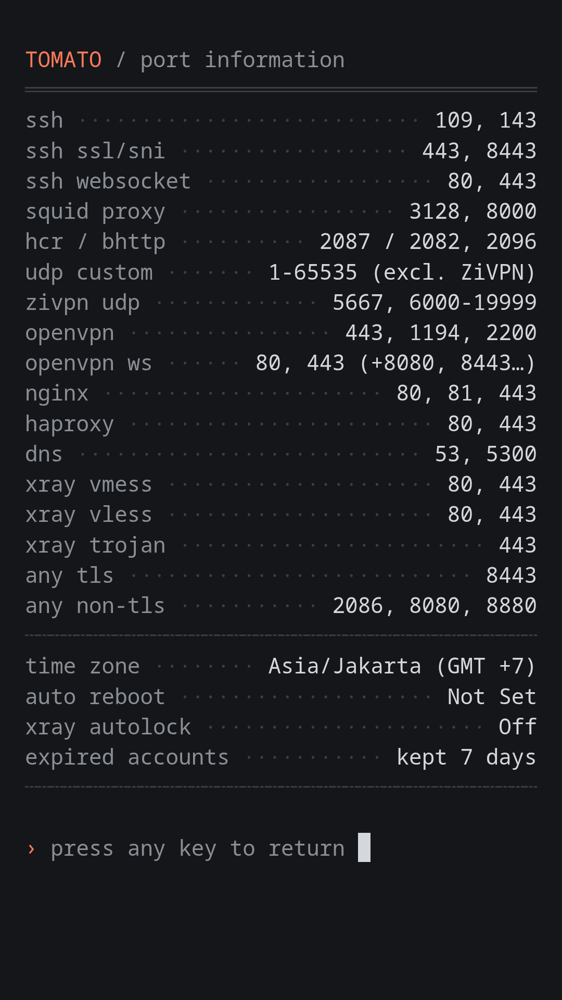
  

<b>Subscription Pages, Server Status & API</b>

 

  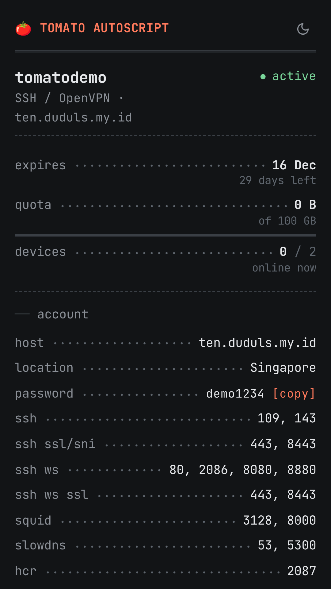
  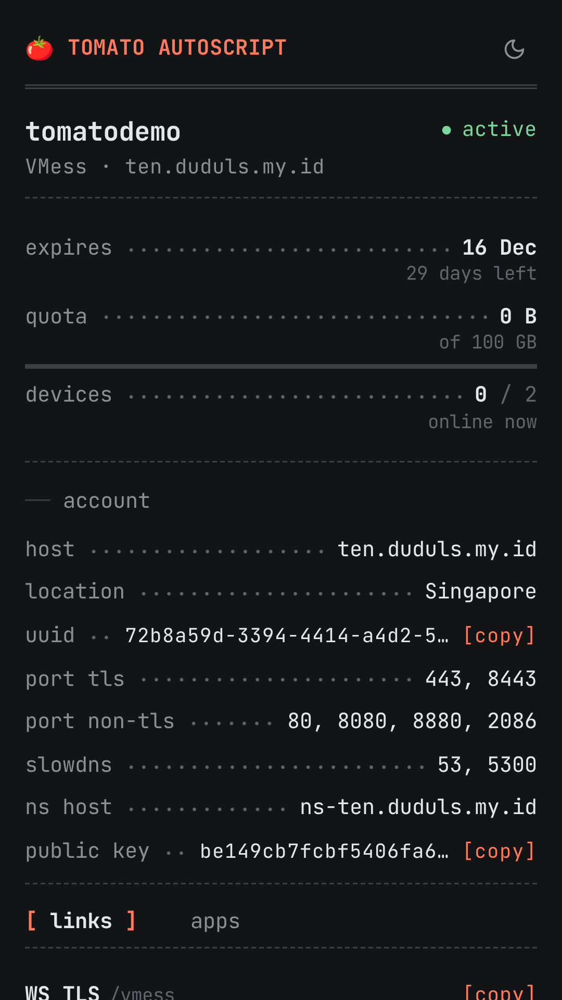
  
  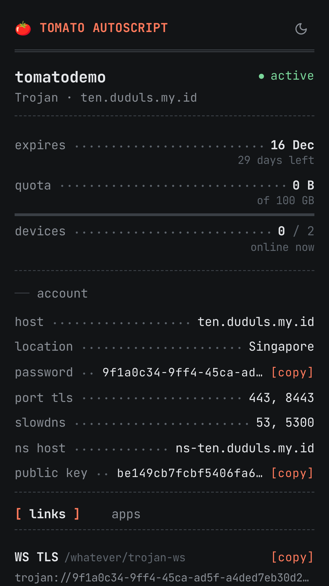
  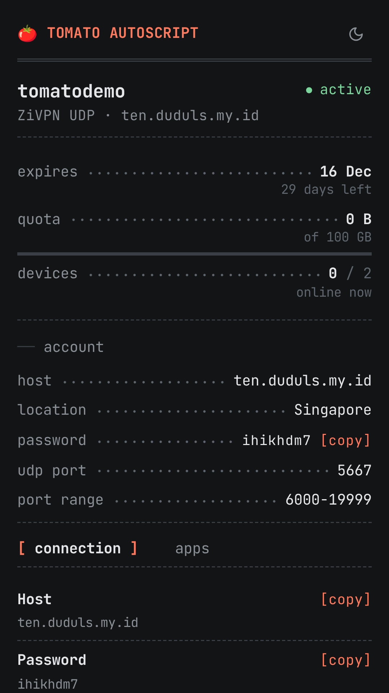
  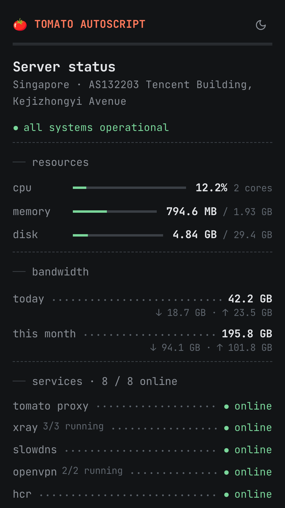
  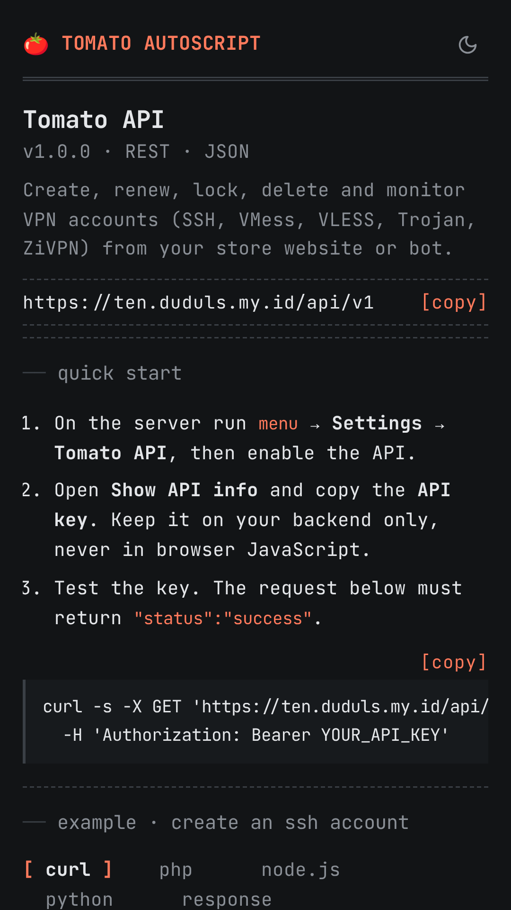

<b>Telegram Bot</b>

 

  
  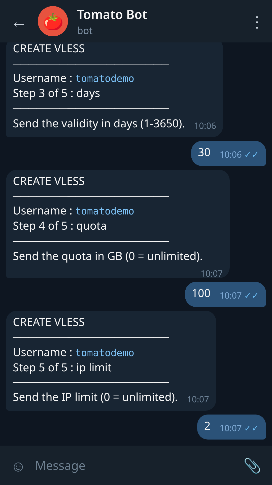
  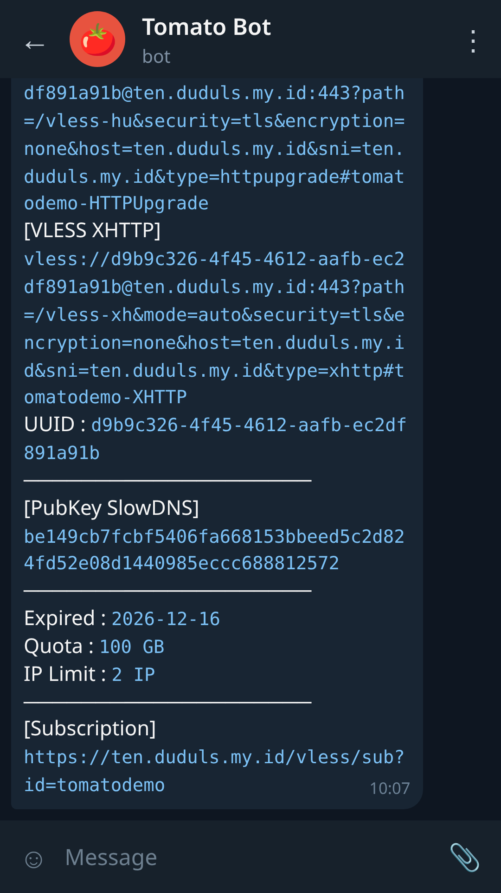

### VPS Requirements
| | Minimum |
|---|---|
| CPU | 1 Core |
| RAM | 1 GB |
| Storage | 10 GB |
| Architecture | x86_64 / AMD64 |
| OS | Debian 12 / 13 · Ubuntu 22.04 / 24.04 / 26.04 (fresh install) |
| Access | root |

> Recommended: **Ubuntu 24.04 LTS** or **Debian 12**.

### How to Order & Install
1. Buy a license at **[store.dudul.my.id/license](https://store.dudul.my.id/license)** — pick a duration (up to 1 year) and IP limit, pay, and the license is active right away.
2. Open your license page in the store, copy the install command shown there, and run it on your VPS as **root**.
3. Follow the on-screen steps (use your own domain or the built-in free DNS).
4. Done — type `menu` to start creating accounts.

> Moving to a new VPS IP? Change it yourself from the license page in the store.

### How to Update
`menu` → `6` Settings Menu → `16` Update script

### Payment Methods
`QRIS` · `DANA` · `ShopeePay` · `Bank Transfer` · `PayPal`

### Add-on: Telegram Store Bot (open source)
Sell Tomato accounts from Telegram with automatic top up (AutoGoPay, Midtrans, Pakasir QRIS + VA), multi-server, in one small binary — **[tomato-store-bot](https://github.com/dudul19/tomato-store-bot)** (MIT).

### Donation

  

#### Credit

 > - [MrDudul](https://t.me/dudulrealnofek)
 > - Telegram Group: [t.me/tfnuklir](https://t.me/tfnuklir)

  `made with 🤍 from Mr Dudul`

