

## `🍅 Tomato Autoscript — Premium VPN Server 🚀` *

`made with 🤍 from Mr dudul`

---

**One script, every protocol. Deploy a premium VPN server on your VPS in about 2 minutes.**

SSH · OpenVPN · VMess · VLESS · Trojan · ZiVPN · HCR · BHTTP · SlowDNS · UDP Custom

  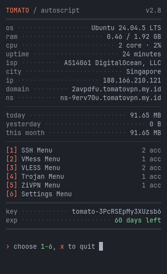
  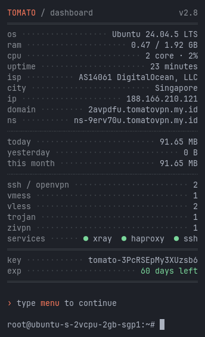

### Why Tomato?
- ⚡ **Lightweight** — the SSH core is written in **Rust** and runs comfortably on a **1 core / 1 GB RAM** VPS.
- 🔐 **Quota & IP limits on every protocol** — SSH, OpenVPN and ZiVPN included, not just Xray.
- 🔄 **One-click updates** — if anything fails midway, it rolls back automatically and every account stays intact.
- 🛒 **Ready to sell** — REST API for selling websites, multi-server Telegram bot, a subscription page for every account.
- 🛡️ **Regular security updates** — binaries are rebuilt whenever an important CVE lands; end-of-life OS versions are not forced to keep running.

### Protocols & Ports
| Service | Port |
|---|---|
| 🦀 SSH (Tomato Proxy) | `109` `143` |
| 🌐 SSH WebSocket | `80` `443` · nTLS `2086` `8080` `8880` |
| 🔒 SSH SSL / SNI | `443` `8443` |
| 📡 OpenVPN TCP · UDP · SSL | `1194` `2200` `443` |
| ✨ VMess · VLESS · Trojan (WS, gRPC, HTTPUpgrade, XHTTP) | TLS `443` · nTLS `80` |
| ⚡ ZiVPN UDP | `5667` `6000-19999` |
| 💉 HCR · BHTTP | `2087` · `2082` `2096` |
| 🧬 SlowDNS · UDP Custom | `53` `5300` · `1-65535` |
| 🎮 UDPGW | `7100` `7200` `7300` |

> One SSH account works on every SSH-based path (WS, SSL, OpenVPN, HCR, BHTTP, SlowDNS, UDP Custom).

### Features
| 👤 Accounts | 📊 Control | 🤖 Automation |
|---|---|---|
| Create, Renew, Detail, Trial | Quota & IP limit on all protocols | Auto-delete expired accounts |
| Custom UUID & password | Lock / Unlock + Autolock | Auto-remove when quota runs out |
| Check login with IP & ISP | Multi-login & quota alerts | Auto backup to Telegram |
| Subscription links for all protocols | Real-time bandwidth monitoring | Encrypted web backup & restore |
| Multi-server Telegram bot | Anti-DDoS & anti-torrent | Free DNS record & auto TLS |
| REST API for selling websites | Xray relay routing | Scheduled auto reboot |

### Preview

<b>🖥️ Terminal Menus</b>

 

  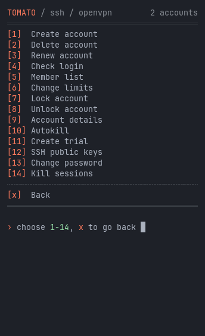
  
  
  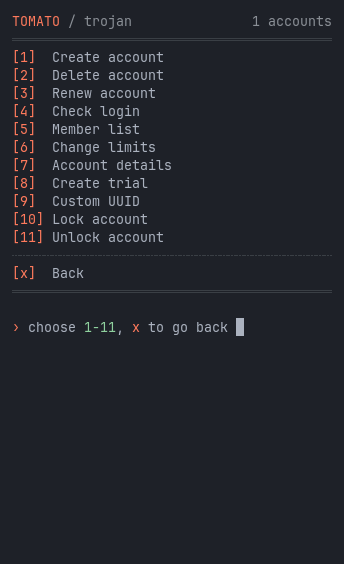
  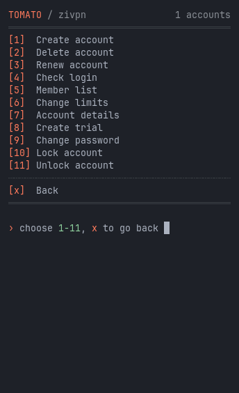
  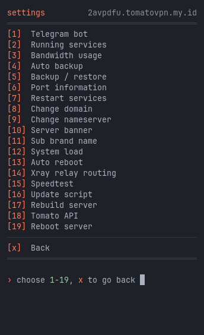

<b>📱 Subscription Pages & Server Status</b>

 

  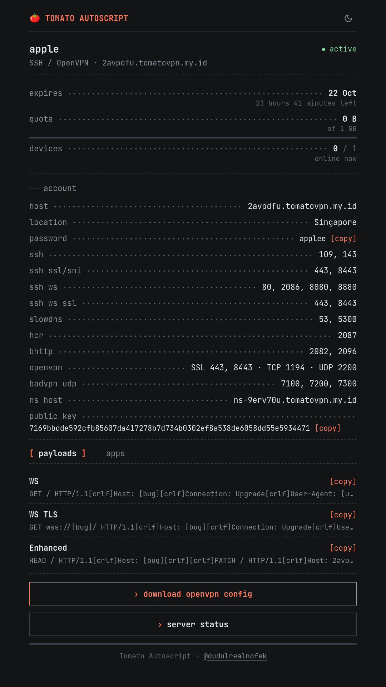
  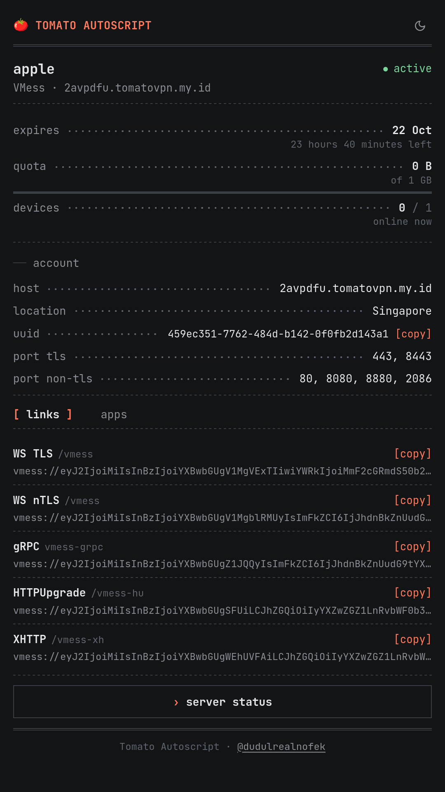
  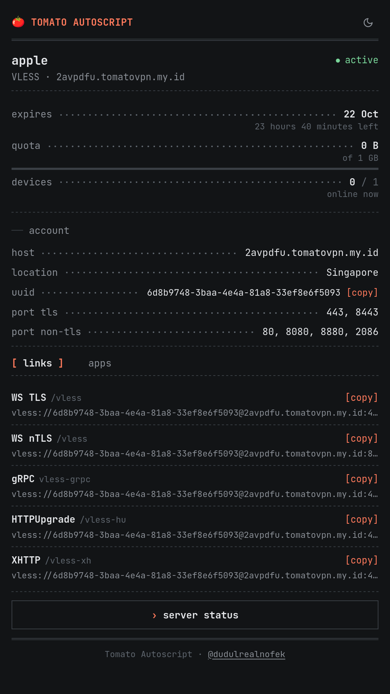
  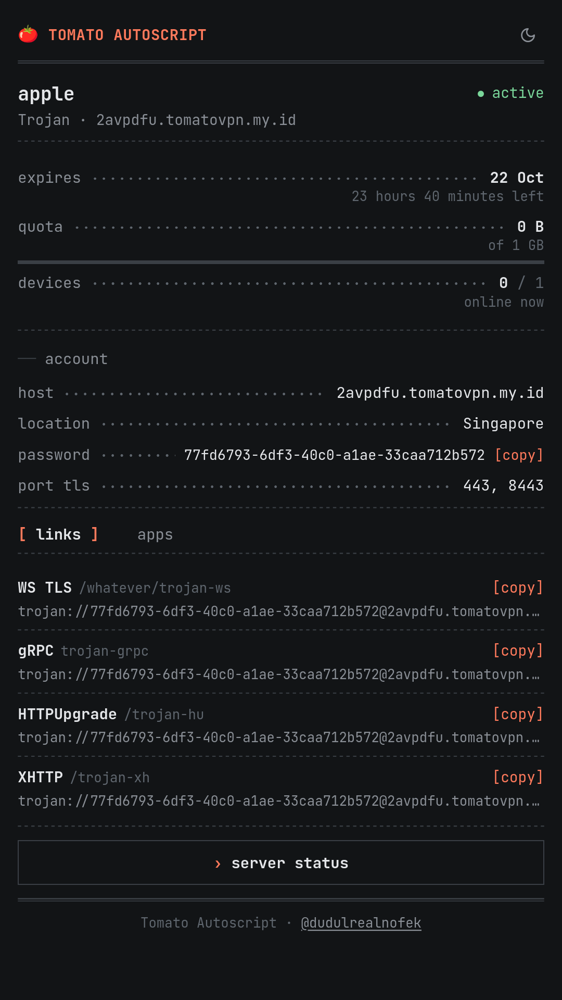
  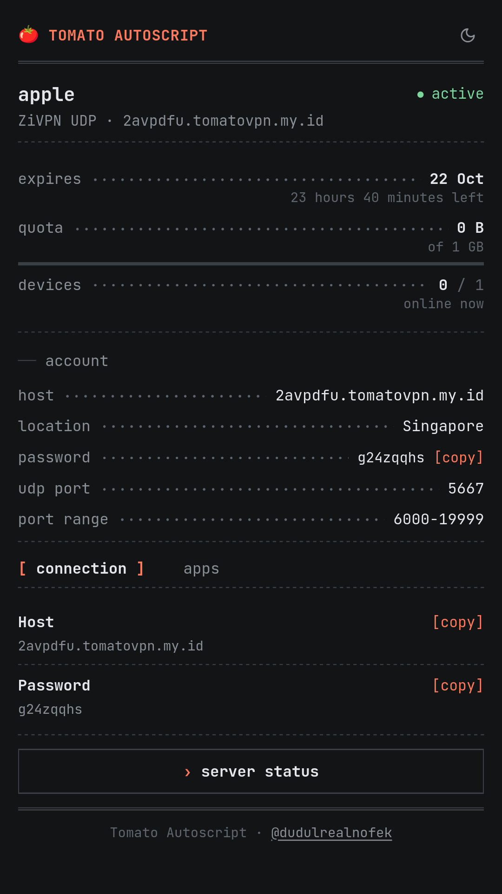
  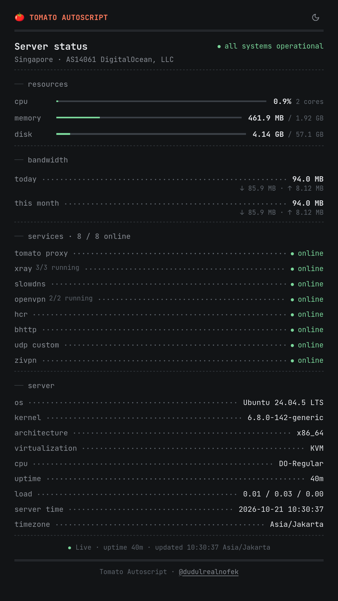

<b>🤖 Telegram Bot</b>

 

  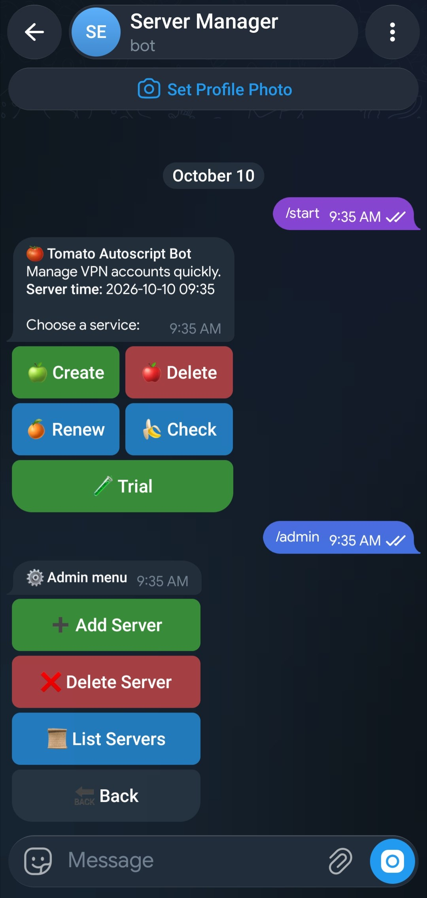

### VPS Requirements
| | Minimum |
|---|---|
| CPU | 1 Core |
| RAM | 1 GB |
| Storage | 10 GB |
| Architecture | x86_64 / AMD64 |
| OS | Debian 12 / 13 · Ubuntu 22.04 / 24.04 / 26.04 (fresh install) |
| Access | root |

> ★ Recommended: **Ubuntu 24.04 LTS** or **Debian 12**.

### How to Order & Install
1. 🛒 Buy a license at **[store.dudul.my.id/license](https://store.dudul.my.id/license)** — pick a duration and IP limit, pay, and the license is active right away.
2. 🔑 Open your license page in the store and copy the install command shown there, then run it on your VPS as **root**.
3. 🌐 Follow the on-screen steps (use your own domain or the built-in free DNS).
4. ✅ Done — type `menu` to start creating accounts.

> Moving to a new VPS IP? Change it yourself from the license page in the store.

### Payment Methods
`QRIS` · `DANA` · `ShopeePay` · `Bank Transfer` · `PayPal`

### Donation

  

#### Credit

 > - [MrDudul](https://t.me/dudulrealnofek)
 > - Telegram Group: [t.me/tfnuklir](https://t.me/tfnuklir)

  `made with 🤍 from Mr Dudul`

