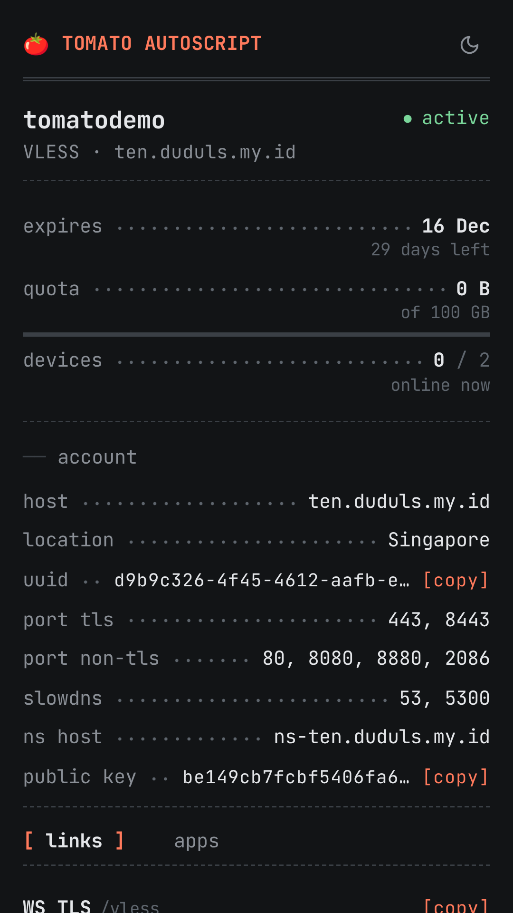
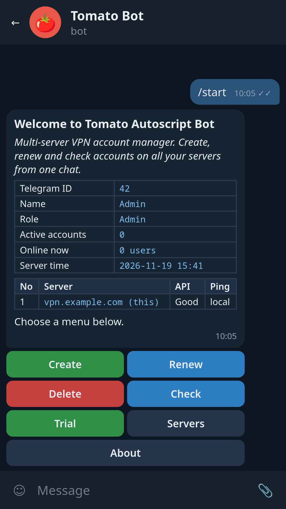

## `Tomato Autoscript`

`made with 🤍 from Mr dudul`

---

Multi-protocol VPN server autoscript for Debian & Ubuntu.

SSH · OpenVPN · VMess · VLESS · VLESS REALITY · Trojan · ZiVPN · HCR · BHTTP · SlowDNS · UDP Custom · Squid Proxy

### What's New in 4.0
- VLESS REALITY on port 443, up to 3 SNI per server. Every VLESS account gets the REALITY link automatically.
- Each REALITY SNI is checked for TLS 1.3 + X25519 before it is saved.
- Xray core 26.11.9 and ZiVPN rebuilt with security fixes.
- The update checks the Xray config before restarting and rolls back if it fails. Relay routing is migrated automatically.

### Features
- SSH core written in Rust, runs on a 1 core / 1 GB RAM VPS.
- Quota and IP limit on every protocol, including SSH, OpenVPN and ZiVPN.
- Check Login with mobile operator and city; multi-login and quota alerts.
- Lock / unlock and autolock with custom durations (e.g. `45m`, `2d12h`).
- Custom UUID and password, from the menu or the API.
- Expired accounts kept for 7 days (0–30, adjustable); renewing restores the same UUID/password.
- Subscription page for every account (incl. Clash).
- SlowDNS for SSH, VMess, VLESS and Trojan.
- REST API, multi-server Telegram bot and auto backup to Telegram.
- Encrypted web backup and restore; the SlowDNS and REALITY keys move with the backup.
- Live dashboard and system monitor.
- Free DNS record, SSL auto-renew, anti-DDoS, anti-torrent, Xray relay routing.
- Updates keep accounts and settings, with automatic rollback.

### Protocols & Ports
| Service | Port |
|---|---|
| SSH (Tomato Proxy) | `109` `143` |
| SSH WebSocket | `80` `2086` `8080` `8880` · SSL `443` `8443` |
| SSH SSL / SNI | `443` `8443` |
| Squid Proxy (SSH remote proxy) | `3128` `8000` |
| OpenVPN TCP · UDP · SSL | `1194` · `2200` · `443` `8443` |
| OpenVPN WebSocket · SSL WS | `80` `2086` `8080` `8880` · `443` `8443` |
| VLESS REALITY | `443` (up to 3 SNI) |
| VMess · VLESS (WS, gRPC, HTTPUpgrade, XHTTP) | TLS `443` `8443` · nTLS `80` `2086` `8080` `8880` |
| Trojan (WS, gRPC, HTTPUpgrade, XHTTP) | TLS `443` `8443` |
| SlowDNS (SSH · VMess · VLESS · Trojan) | `53` `5300` |
| ZiVPN UDP | `5667` `6000-19999` |
| HCR · BHTTP | `2087` · `2082` `2096` |
| UDP Custom | `1-65535` (except ZiVPN range) |
| UDPGW | `7100` `7200` `7300` |

> One SSH account works on every SSH-based path (WS, SSL, Squid, OpenVPN, HCR, BHTTP, SlowDNS, UDP Custom).

### VPS Requirements
| | Minimum |
|---|---|
| CPU | 1 Core |
| RAM | 1 GB |
| Storage | 10 GB |
| Architecture | x86_64 / AMD64 |
| OS | Debian 12 / 13 · Ubuntu 22.04 / 24.04 / 26.04 (fresh install) |
| Access | root |

> Recommended: Ubuntu 24.04 LTS or Debian 12.

### How to Order & Install
1. Buy a license at **[store.dudul.my.id/license](https://store.dudul.my.id/license)** — pick a duration (up to 1 year) and IP limit.
2. Open your license page in the store, copy the install command shown there, and run it on your VPS as **root**.
3. Follow the on-screen steps (use your own domain or the built-in free DNS).
4. Type `menu` to start creating accounts.

> Moving to a new VPS IP? Change it from the license page in the store.

### How to Update
`menu` → `6` Settings Menu → `16` Update script

### Payment Methods
`QRIS` · `DANA` · `ShopeePay` · `Bank Transfer` · `PayPal`

### Add-on: Telegram Store Bot
Sell Tomato accounts from Telegram with automatic top up (AutoGoPay, Midtrans, Pakasir) — **[tomato-store-bot](https://github.com/dudul19/tomato-store-bot)**.

### Preview

  
  
  
  
  
  

 

More screenshots on the website:

### Donation

  

#### Credit

 > - [MrDudul](https://t.me/dudulrealnofek)
 > - Telegram Group: [t.me/tfnuklir](https://t.me/tfnuklir)

  `made with 🤍 from Mr Dudul`

